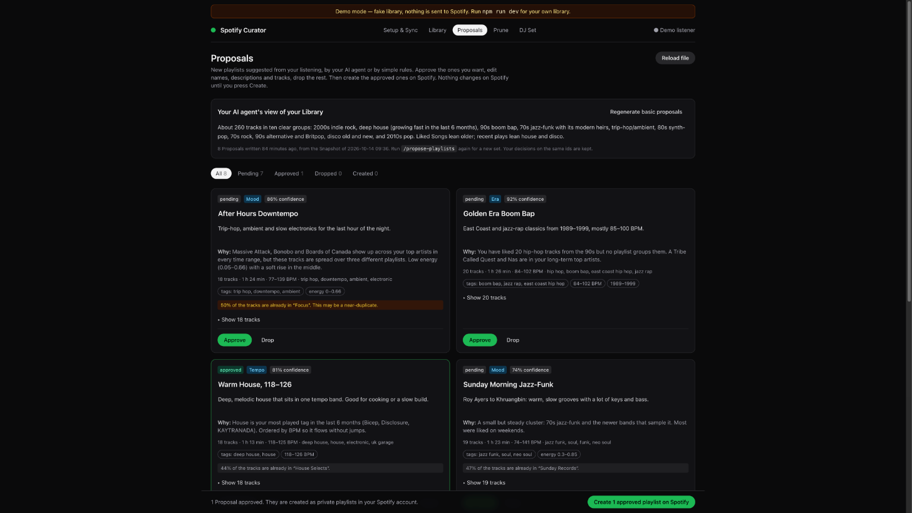
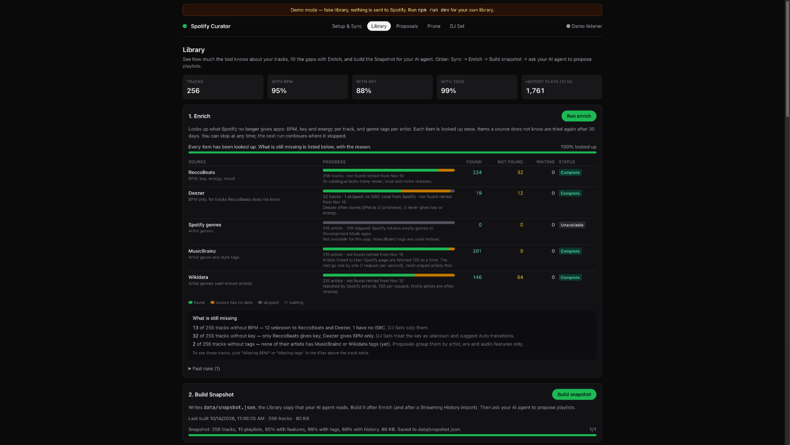
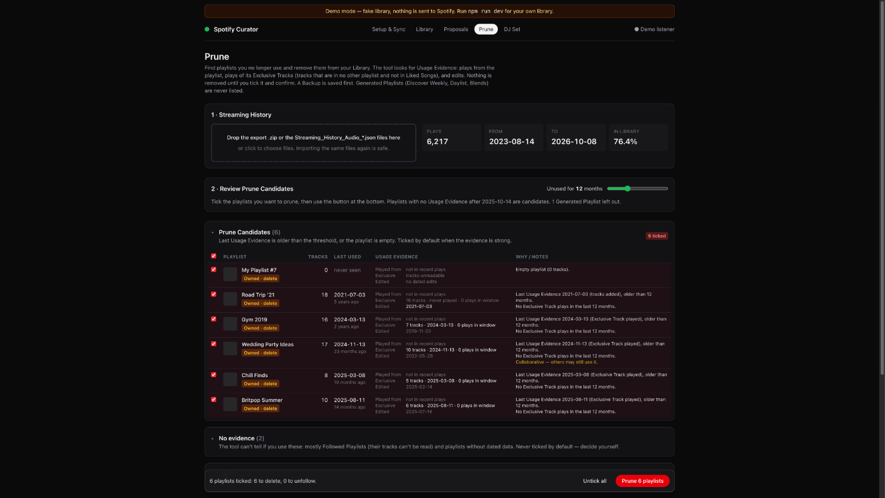
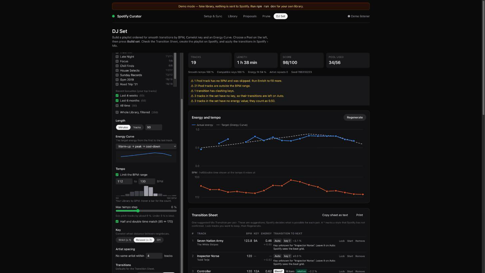

# Spotify Curator

[](https://github.com/stanislavSav/spotify-curator/actions/workflows/ci.yml)
[](LICENSE)


A local web app for your own Spotify account. It analyses your library, proposes new playlists (written by your AI agent or by simple rules), finds playlists you no longer use and removes them safely, and builds DJ sets ordered by BPM, key and energy, with a transition sheet for Spotify Mix.

Everything runs on your machine. Your library stays in a local SQLite file.



## What it does

| | Feature | How |
|---|---|---|
| 1 | **Analyse** | Syncs Liked Songs, your own playlists, top tracks/artists and recent plays. Adds BPM, key and energy from [ReccoBeats](https://reccobeats.com) and [Deezer](https://developers.deezer.com), and genre tags from [MusicBrainz](https://musicbrainz.org) and [Wikidata](https://www.wikidata.org). |
| 2 | **Propose** | Your AI agent reads a compact Snapshot of your library and writes named playlist proposals with reasons. No agent? Press **Generate basic proposals**. You approve, edit or drop each one; the app creates the approved ones on Spotify. |
| 3 | **Prune** | Finds playlists with no recent use, based on your Streaming History export, plays of tracks that only that playlist has, and edit dates. You confirm each one. A backup is saved first and can be restored from the app; Spotify also keeps deleted playlists recoverable for 90 days. |
| 4 | **DJ Set** | Picks tracks from a pool and orders them by BPM, Camelot key and an energy curve you choose, then creates the playlist. The set rebuilds live as you change settings. A **Transition Sheet** card per pair mirrors Spotify's *Edit transition* panel: preset, bars, and the exact Volume / EQ / Filter / Effects / Looping values to pick. Suggestions come from a rule engine that uses key, tempo, energy, vocals/instrumental, acousticness and position in the set, with a **Colour** setting (subtle / medium / bold). Press **✦ AI pass** to have your own AI agent review the sheet. You can edit each card, tick it off as applied, and step through them in a full-screen Apply mode. |

## Before you start

> [!IMPORTANT]
> - **Spotify Premium is required.** Since February 2026, Spotify only lets Premium accounts own a Web API app in Development Mode.
> - **You create your own Spotify app** (about 5 minutes, free) at [developer.spotify.com/dashboard](https://developer.spotify.com/dashboard). Development Mode allows at most 5 users per app, so each person runs the tool with their own app.
> - **Node.js 22.12 or newer**, and macOS, Linux or Windows.
> - **Spotify no longer gives apps audio features** (BPM, key, energy) or **genres**. This tool gets them from third-party services instead, so some tracks will have gaps.
> - **Spotify Mix transitions have no API.** The app sets the track order and gives you a Transition Sheet with the exact values to set. You apply them yourself in the Spotify app (Mix › Edit transition).
> - **Optional, but best for Prune:** request your *Extended streaming history* at [spotify.com/account/privacy](https://www.spotify.com/account/privacy/). It can take up to 30 days to arrive.

## Try it in one minute (demo)

No Spotify app needed. The demo uses a fake library and never contacts Spotify.

```sh
git clone https://github.com/stanislavSav/spotify-curator.git
cd spotify-curator
npm install
npm run demo
```

Open **http://127.0.0.1:5173**. Use `127.0.0.1`, not `localhost`.

## Quick start with your own library

1. Create a Spotify app at [developer.spotify.com/dashboard](https://developer.spotify.com/dashboard). Tick **Web API**. Add this redirect URI exactly:
   `http://127.0.0.1:8787/auth/callback`
2. Copy `.env.example` to `.env` and set `SPOTIFY_CLIENT_ID`. No client secret is needed; the app uses PKCE.
3. Run `npm install` and `npm run dev`, then open **http://127.0.0.1:5173**.
4. **Setup & Sync** → Connect → Sync now.
5. **Library** → Run enrich (the first run takes a few minutes on a big library) → Build snapshot.
6. **Proposals**: ask your AI agent to propose playlists (see below), or press **Generate basic proposals**.

[SETUP.md](SETUP.md) has every step in detail, plus troubleshooting.

## Use it with an AI agent

The proposal workflow is written once in [`.agents/skills/propose-playlists/SKILL.md`](.agents/skills/propose-playlists/SKILL.md), and [`AGENTS.md`](AGENTS.md) points every agent to it. Start your agent in the repository folder:

| Agent | Run |
|---|---|
| Claude Code | `/propose-playlists` (optionally with a focus: `/propose-playlists only 90s`) |
| OpenAI Codex | `$propose-playlists`, or ask "propose playlists" |
| Gemini CLI | `/propose-playlists`, or ask "propose playlists" |
| Cursor | `/propose-playlists` in the agent chat, or ask "propose playlists" |
| GitHub Copilot | `/propose-playlists` in VS Code chat, or ask "propose playlists" |
| Any agent that reads `AGENTS.md` | Ask "propose playlists" |

The agent runs a digest script, reads the Snapshot selectively, writes `data/proposals.json`, and runs `npm run validate-proposals` until it passes. It never calls Spotify. You create the playlists in the app.

| File | Read by |
|---|---|
| `AGENTS.md` | Codex, Cursor, Copilot, Gemini CLI (via `.gemini/settings.json`), and most other agents |
| `CLAUDE.md` | Claude Code (it imports `AGENTS.md`) |
| `.agents/skills/` | Codex, Gemini CLI, Cursor, Copilot |
| `.claude/skills/` | Claude Code (a thin wrapper around the shared skill) |
| `.gemini/commands/` | Gemini CLI slash command |

## How it works

```
Spotify Web API ──sync──▶ SQLite (data/curator.sqlite) ◀──enrich── ReccoBeats · Deezer · MusicBrainz · Wikidata
                                │
                                ├─▶ Snapshot (data/snapshot.json) ──▶ your AI agent ──▶ data/proposals.json ─┐
                                │                                     (or Basic Proposals, by rules)         │
                                ├─▶ Prune: Usage Evidence + Streaming History import                          │
                                └─▶ DJ Set: pool → order (BPM, key, energy curve) → Transition Sheet          │
                                                                                                              ▼
                                         Web app (review, edit, confirm) ──▶ Spotify: create / remove playlists
```

| Part | Tech |
|---|---|
| `apps/web` | Vite, React 19, TanStack Query, Tailwind CSS v4 |
| `apps/server` | Hono on Node 22, better-sqlite3, background jobs |
| `packages/shared` | Types, Camelot helpers, Snapshot and Proposal contracts (zod) |

<details>
<summary>More screenshots</summary>

**Library and enrichment**


**Prune**


**DJ Set and Transition Sheet**


</details>

## Privacy

- Your data stays in `data/` on your machine: the database, Snapshot, Proposals and Backups. It is git-ignored.
- Spotify login uses PKCE. Tokens are stored only in the local database.
- To fill in what Spotify no longer provides, the enrich step sends **only identifiers** to these services:

  | Service | Receives |
  |---|---|
  | ReccoBeats | Spotify track IDs |
  | Deezer | ISRC codes |
  | MusicBrainz | ISRC codes, Spotify artist page URLs, artist names |
  | Wikidata | Spotify artist IDs |

- Your AI agent reads `data/snapshot.json` on your machine. The **✦ AI pass** on the DJ page runs your installed agent CLI (Claude Code, Codex or Gemini CLI) with the set's track names, artists and audio features as text, without tools. What your agent's provider does with that data depends on the agent you use.
- `npm run check:public` and a pre-commit hook block commits of `data/`, `.env`, snapshots, proposals, databases and likely secrets. Put your own names, emails or playlist names in `.private-markers` (git-ignored) to block those too.

## Commands

| Command | What it does |
|---|---|
| `npm run dev` | Starts the server (`:8787`) and the web app (`:5173`) |
| `npm run demo` | Same, with a fake library in `data/demo/`; Spotify writes are blocked |
| `npm test` | All tests (Vitest + privacy guard) |
| `npm run typecheck` | Type-checks all packages |
| `npm run check:public` | Privacy scan of everything git would publish |
| `npm run snapshot` | Writes `data/snapshot.json` from the command line |
| `npm run validate-proposals` | Checks `data/proposals.json` against the schema and the database |

The DJ page's **✦ AI pass** uses the first agent CLI it finds (`claude`, `codex`, `gemini`); set `AGENT_CLI` in `.env` to choose. Ports can be changed with `PORT` and `WEB_PORT`. For example, `PORT=8797 WEB_PORT=5183 npm run demo` runs the demo next to your real app. If you change `PORT`, update the redirect URI in your Spotify app too.

## Limitations

- Spotify returns no tracks for **playlists you follow but don't own**. They can be pruned, but not analysed.
- Spotify has **no "last opened" date** for playlists. Prune infers use from your Streaming History, recent plays and edit dates. Without the export, the evidence is weak.
- Third-party sources miss some tracks: newer, local or niche releases often have no BPM, key or tags.
- Spotify refresh tokens expire **6 months** after login. The app tells you when to log in again.

## Docs

- [SETUP.md](SETUP.md): full setup, workflow and troubleshooting
- [CONTEXT.md](CONTEXT.md): the glossary (Library, Snapshot, Proposal, Prune Candidate, DJ Set, Transition Sheet…)
- [docs/adr](docs/adr): architecture decisions
- [docs/tasks](docs/tasks): research, decisions and implementation notes, one folder per task

## Contributing

This repository does not accept pull requests. To change it, **fork it**; [CONTRIBUTING.md](CONTRIBUTING.md) explains the layout, checks and docs workflow. Bug reports are welcome as [issues](https://github.com/stanislavSav/spotify-curator/issues).

## License

[MIT](LICENSE). This project is not affiliated with or endorsed by Spotify. Spotify is a trademark of Spotify AB.
